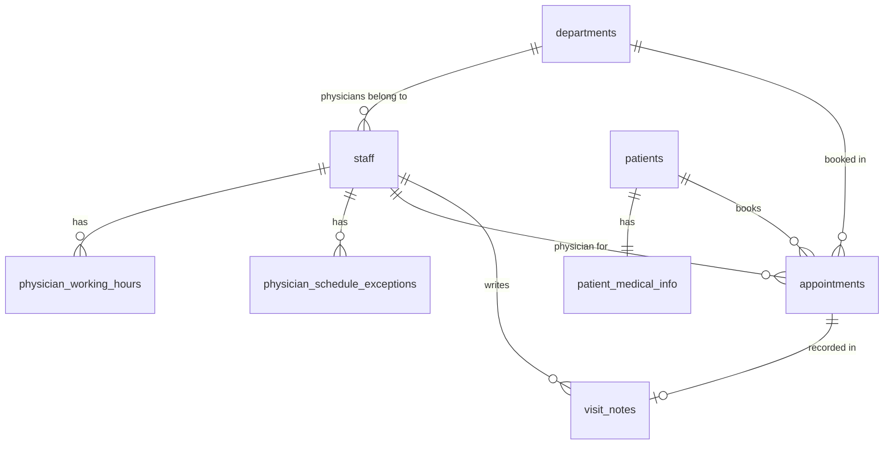

# Waitless

Clinic scheduling and lightweight patient records, built so patients spend less time waiting and staff always know who is next.

Patients book online without an account. Front desk staff check them in and watch the day's schedule update live. Physicians work through their own queue and record visit notes. When a consultation runs late, the system moves the physician's later appointments for the rest of the day, or flags them for staff review when moving them isn't safe.

> **Status:** the Supabase backend (database, security rules, scheduling logic, Edge Functions and tests) is complete. Every frontend screen is built and runs on mock data; connecting it to the API and a live demo are next.

## Features

**Public booking (no login)**
- Choose a department and an available 40-minute slot. Taken slots are shown as unavailable.
- A free physician in that department is assigned automatically, spreading the day's workload.
- Returning patients are matched by phone number. `0803 123 4567` and `+2348031234567` count as the same patient.
- A booking reference code is used, together with the phone number, to look up, reschedule or cancel a booking.

**Front desk**
- Live list of the day's appointments (Supabase Realtime).
- Check in patients, mark no-shows, book, reschedule, cancel.
- Reassign appointments to another physician, one at a time or all of a physician's at once.

**Physicians**
- Queue of checked-in patients, with each patient's previous visit notes.
- Start a consultation → save a visit note (symptoms, diagnosis, prescription) → complete it.

**Admins**
- Invite staff by email and assign roles.
- Change roles, deactivate and reactivate accounts, resend invites.
- Appointment data per department for analytics.

## Scheduling rules

| Rule | Value |
|---|---|
| Opening hours | Monday–Friday, 08:40–17:00 (Africa/Lagos) |
| Lunch break | 12:00–13:00 |
| Appointment length | 40 minutes (35 with the patient + 5 rest) |
| Slots per physician per day | 11 |
| Booking window | At least 1 hour ahead, at most 30 days ahead |
| Upcoming bookings per patient | At most 3 |

## How it works

### Security first

Every rule lives in the database, not the frontend, so it can't be bypassed by calling the API directly.

- **Row Level Security** on every table. Physicians only see their own appointments, and patient records only for patients they treat. Front desk staff never see clinical notes or medical information.
- **No direct writes.** Every change to appointments, notes and staff goes through `SECURITY DEFINER` database functions that check the caller's role and the appointment's current state.
- **Deactivated staff are locked out instantly.** Every permission check ignores inactive accounts, and their login is also banned.
- Supabase's default table privileges are revoked. This includes `TRUNCATE`, which bypasses Row Level Security.

### No double-booking, even under load

- PostgreSQL **exclusion constraints** stop the same physician or the same patient from holding overlapping appointments.
- Public bookings for the same department and time are processed one at a time using **advisory locks**, so two patients clicking the same slot simultaneously cannot be given the same physician.
- The constraints are `DEFERRABLE`, so the delay logic can move a whole afternoon of appointments in one transaction.

### Handling delays

When a physician completes a consultation late, `complete_consultation` works out how late it ran and checks every later appointment that day:

- Would it still fit inside working hours?
- Would it still be on the same day?
- Would it avoid the physician's days off?
- Would it avoid clashing with another appointment, for the physician or the patient?

If every appointment passes, they all move later by the same amount, keeping the gaps between them. If any would fail, nothing moves; the appointments are flagged for front desk review instead.

## Data model



Appointment lifecycle: `scheduled → checked_in → in_progress → completed`, with `cancelled` and `no_show` as alternative endings. Database constraints keep each status consistent with its timestamps.

## Tech stack

- **Database & API:** Supabase (PostgreSQL, PostgREST, Row Level Security, Realtime)
- **Server logic:** PL/pgSQL functions, Supabase Edge Functions (Deno, TypeScript)
- **Testing:** pgTAP, 61 end-to-end database tests
- **Frontend:** React 19, TypeScript, Vite, TanStack Router (file-based, type-safe routes and search params), TanStack Query, Tailwind CSS v4, Radix UI, Recharts

## Running locally

**Requirements:** [Supabase CLI](https://supabase.com/docs/guides/cli) and Docker (or [OrbStack](https://orbstack.dev) on macOS).

```bash
git clone git@github.com:Tomiogunsan/Waitless.git
cd Waitless

supabase start      # starts Supabase locally and applies all migrations
supabase test db    # runs the database test suite
```

| Local service | URL |
|---|---|
| Studio (dashboard) | http://127.0.0.1:54323 |
| API | http://127.0.0.1:54321 |
| Mailpit (catches invite emails) | http://127.0.0.1:54324 |

To run the Edge Functions: `supabase functions serve`.

**Frontend** (currently runs on mock data, no backend needed):

```bash
cd web
cp .env.example .env.local   # then paste the publishable key from `supabase status`
npm install
npm run dev                  # http://localhost:5173
```

On the sign-in page, choose **Front desk**, **Physician** or **Admin** to explore each role.

**Demo data:** `supabase db reset` loads [`supabase/seed.sql`](supabase/seed.sql): staff, patients, a busy "today", upcoming bookings and 90 days of history. Every demo account uses the password `Waitless-demo-2026`:

| Role | Email |
|---|---|
| Admin | `folake@waitless.health` |
| Front desk | `chidinma@waitless.health` |
| Physician | `adaeze@waitless.health` |

Public booking demo: reference `CLN-7F3A9C21B4E8` with phone `0803 123 4567`.

**In production**, staff join by invitation, so the first admin is created by hand: add a user under **Authentication → Users** in the Supabase dashboard, then run:

```sql
INSERT INTO public.staff (id, full_name, role)
VALUES ('<the new user id>', 'Your Name', 'admin');
```

## Project structure

```
web/src/
├── routes/                # File-based routes (TanStack Router)
│   ├── _public/           # Booking, confirmation, manage booking
│   ├── _auth/             # Sign in, set password
│   └── _modules/          # Front desk, physician, admin, patients
├── shared/                # Reusable UI: one folder per component (interface.ts + component)
├── components/            # Feature components: booking, front-desk dialogs, charts
├── utils/                 # Formatting, time zone, scheduling rules, session, guards
├── mocks/                 # Mock data shaped like the database tables
└── types/                 # Types mirroring the Supabase schema

supabase/
├── migrations/
│   ├── ..._create_clinic_tables.sql              # Tables, constraints, indexes
│   ├── ..._secure_clinic_data.sql                # RLS policies and staff workflow functions
│   ├── ..._default_physician_working_hours.sql   # Clinic hours and automatic schedules
│   ├── ..._public_booking.sql                    # Patient booking, lookup, Realtime
│   └── ..._staff_management.sql                  # Deactivation, role changes, reassignment
├── functions/
│   ├── _shared/          # Admin check and HTTP helpers
│   ├── invite-staff/     # Invite a staff member by email
│   └── manage-staff/     # Deactivate, reactivate, resend invite
└── tests/database/
    └── clinic_flows.test.sql
```

## Roadmap

- [x] Database schema, security rules and scheduling logic
- [x] Public booking with automatic physician assignment
- [x] Staff invitations and account management
- [x] End-to-end database tests
- [x] Frontend screens for every role, on mock data
- [ ] Connect the frontend to Supabase (auth, queries, Realtime)
- [ ] Live demo with sample data and demo logins for each role
